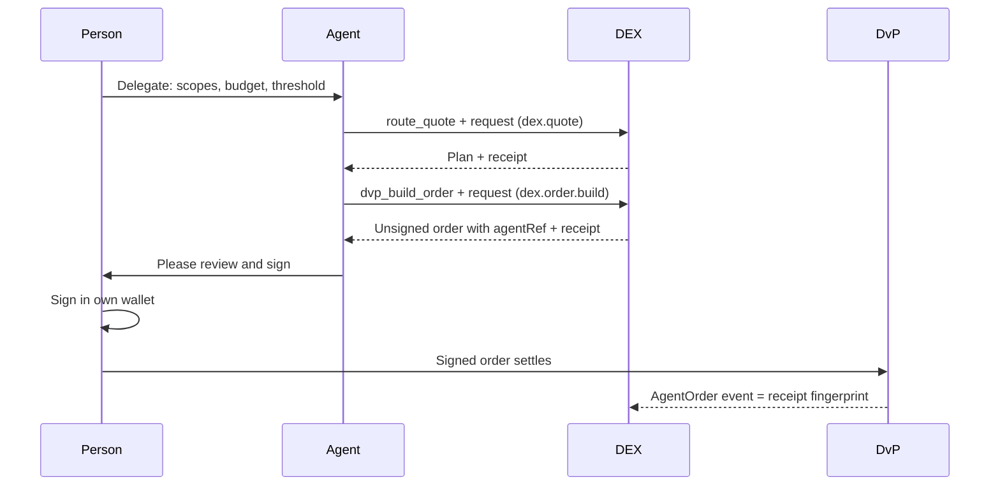

# Agents & the Agent Environment

> AI agents can **shop, compare and prepare** trades for a person, within limits the person set. They can never **sign or spend**: the person's own wallet signature is always the last step.

## Where the agent rules come from

The rules for agents are not invented inside the DEX. They come from the public **[Autheo Agent Environment](https://github.com/SolutionsAsService/autheo-agent-environment)** (SolutionsAsService), a tested reference prototype for agent identities, mandates, decisions and signed receipts. It publishes a venue profile ([SPEC-VENUE](https://github.com/SolutionsAsService/autheo-agent-environment/blob/main/docs/SPEC-VENUE.md)) that says exactly how any exchange should treat an agent, plus a small JavaScript verifier, `@autheo/did`.

The DEX uses a **pinned, byte-for-byte copy** of that verifier (version 0.7.0, upstream commit `7f3d981`, MIT licence, SHA-256 checked). A test fails if the copy ever drifts, and another replays every upstream "venue decision" test case, so the DEX decides exactly as the agent environment would. Nothing is fetched at run time: verification is offline. Status: {built} (ADR 0006, commits `53caf04` and `27c34c9`).

## The pieces, in plain words

| Piece | Plain meaning | In the DEX |
| --- | --- | --- |
| **Identity** | Every person and agent has a DID (`did:key`): a public key made locally. No registry, no server | The DEX has its own DID too, used only to sign receipts |
| **Principal** | The person the agent works for; the root of the chain | The DEX accepts only principals on its trusted list (configuration) |
| **Delegation chain** | Signed permission slips (W3C Verifiable Credentials): person → agent → sub-agent. Each link can only **narrow** what it received | Widened or revoked chains are refused (unit tests and end-to-end run) |
| **Mandate** | What the slip allows: scopes, resources, per-action limit, total budget, approval threshold, delegation depth | Checked on every call |
| **Budget asset** | The unit all amounts are counted in, e.g. `erc20:<token address>` in minor units | For orders, the amount is what the person gives up |
| **Invocation** | The agent's signed request for one specific call, carrying its chain | Must name exactly this call; each one works once (replays refused) |
| **Receipt** | A signed record of each decision (`autheo.receipt/v2`), hash-linked into a ledger anyone can verify | Signed by the DEX's DID; also written into the DEX audit log |

## What an agent may ask for: the `dex.*` scopes

| Scope | The agent asks the DEX to... | Where the DEX checks it | Status |
| --- | --- | --- | --- |
| `dex.quote` | price a trade or route (read only) | MCP `route_quote`, router `POST /quote` | {built} |
| `dex.policy_check` | explain whether a transfer would pass the asset's rules (read only) | MCP `policy_check` | {built} |
| `dex.order.build` | build an **unsigned** order for the person to sign | MCP `dvp_build_order` | {built} |
| `dex.order.request_signature` | put a built order in front of the person for signature | Recognised by the verifier; no DEX tool uses it yet | {planned} |

`dex.order.request_signature` never means "sign for me". It was called `dex.order.sign` until agent-environment 0.7; the old name was renamed because it invited exactly that misreading. The old name still works as a deprecated alias until 0.8 (commit `27c34c9`, 13 Oct 2026).

Resources name a chain and an asset: `chain:<chain>:asset:<asset id>`. A grant for `chain:autheo-l1:*` covers every asset on that chain.

## What happens to a request

1. **Verify offline.** Signatures, chain back to a trusted principal, expiry, revocations. Forged or tampered requests are refused and only audited.
2. **Bind to the call.** The request must name this exact scope, resource, amount and budget asset, and be addressed to this DEX. Anything else is refused.
3. **Decide** with the agent environment's mandate rules (block beats escalate beats allow):
   - **allow**: proceed. For orders, return `ready_for_signature` with an unsigned order.
   - **escalate**: return `needs_human_approval` with the order or plan, the person who must approve, and the reasons. Nothing is counted against the agent's budget. The person approves by signing with their own wallet, or not at all.
   - **block**: refuse with reasons.
4. **Bind the order.** The order gains `agentRef` = the fingerprint of the agent's request. The person signs over it, so they see which agent asked, and relabelling the order breaks the signature. Settlement emits `AgentOrder(tradeId, maker, agentRef)`.
5. **Record.** A signed receipt per decision, hash-chained and exportable (`autheo.ledger-export/v2`); a bundle of receipt + request verifies offline with the agent environment's own tools. Every decision and refusal is also appended to the DEX audit log with the receipt fingerprint, so the on-chain audit anchor covers agent activity too.

The DEX's own transfer-rule pre-check runs on every route as well: a mandate never overrides the asset's rules.

## Proven in the end-to-end run

- An agent with a mandate quotes and builds an order; the buyer signs; DvP settles; the `AgentOrder` event equals the receipt fingerprint; the receipt bundle verifies offline.
- An order above the approval threshold returns **needs human approval**.
- A sub-agent whose chain tries to widen its limits is **refused**; a revoked chain is **refused**.
- All agent receipts verify as an agent-environment ledger.

## Known limits (open)

- {open} **Budgets live in memory**, per DEX instance. A restart forgets spend; receipts are not persisted yet.
- {open} **No DID-to-wallet binding yet.** Any trusted principal's agent can *prepare* an order for any wallet. Harmless for custody (the wallet owner must still sign) but noisy; binding is M1 work.
- {open} **Spend is capped per venue.** The DEX only sees its own receipts; spend across several venues is only capped if they share an environment.
- Only the built-in mandate rules are applied; the agent environment's declarative policy files need its Python service.
- `dex.order.request_signature` is accepted in delegations, but the DEX has no "present to signer" tool yet.
