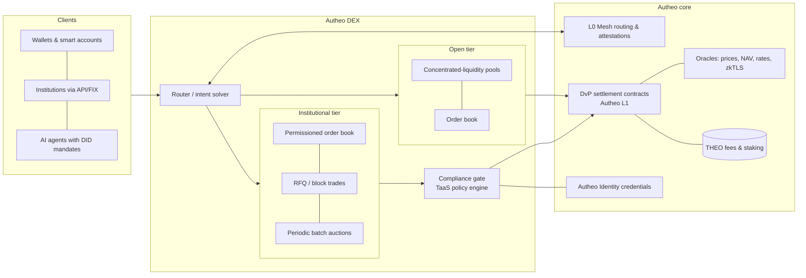

# Architecture

## Components
| Component | Role | Notes |
| --- | --- | --- |
| **Router / intent solver** | Takes "sell X for Y, deliver on chain Z" and finds the best path across tiers, venues and chains | Users state intents; solvers compete; L0 Mesh moves value between chains |
| **Open tier** | Concentrated-liquidity AMM + order book for permissionless assets (THEO, majors, stablecoins) | Standard DeFi semantics, no KYC |
| **Institutional tier** | Permissioned order book, RFQ for blocks, periodic batch auctions for thin RWA markets | Every participant holds a verified credential; operated with a licensed partner (ATS/MTF) |
| **Compliance gate** | Calls the TaaS policy engine before an order rests and again at settlement | Same rules as TaaS transfers: KYC, sanctions, jurisdiction, eligibility, limits, lock-ups |
| **Settlement** | Atomic DvP on Autheo L1: asset leg and cash leg move together or not at all | Cash legs: tokenized deposits / regulated stablecoins |
| **Identity** | Autheo Identity verifiable credentials bound to wallets and agent DIDs | Holder proves eligibility without exposing PII |
| **L0 Mesh** | Cross-chain routing and attestations; canonical RWA supply stays on L1 | Policy travels with the asset to every chain |
| **Oracles** | Prices, NAV, rates; zkTLS attestations for off-chain facts (reserves, balances) | Circuit breakers on stale/deviating feeds |
| **Custody** | Smart accounts, MPC/HSM custodians, agent mandates | Institutions keep their custodian |
| **THEO** | Fee asset, staking for fee tiers and solver/relayer bonds | Never the settlement asset for regulated instruments |

## Design choices
1. **One venue, two tiers, one settlement layer.** Liquidity can be routed between tiers only where the asset's rules allow (an RWA token never enters an open pool).
2. **Order books and auctions for RWAs, AMMs for crypto.** Thin, slow-moving instruments price better in batch auctions and RFQ than in constant-function pools; AMMs stay for deep, fungible pairs.
3. **Fair ordering.** Frequent batch auctions and sealed (hybrid X25519 + ML-KEM encrypted) order submission remove most front-running and sandwiching.
4. **Policy at two points.** Pre-trade (an ineligible order never reaches the book) and at settlement (state may have changed).
5. **Post-quantum ready.** Institutions choose a security profile (compact / balanced / max); settlement and audit records carry hybrid Ed25519 + ML-DSA signatures.
