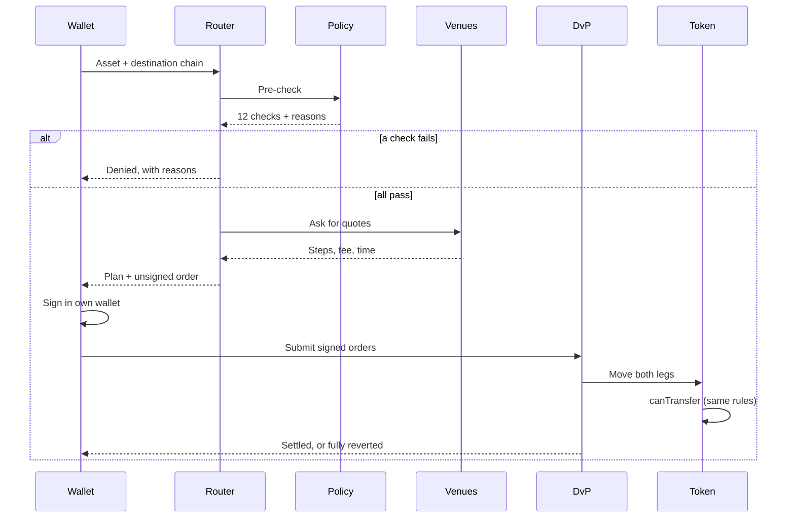
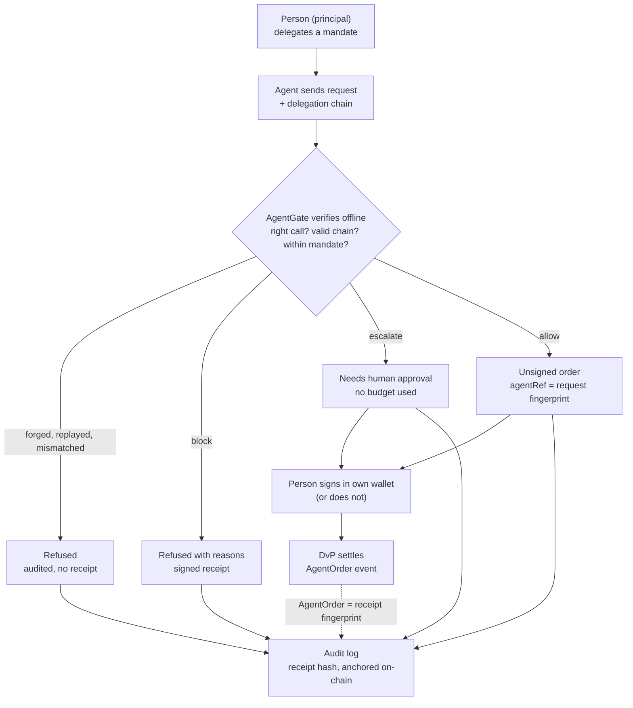

# Architecture

> The short version: **users and agents ask; Autheo checks and plans; only the user's own wallet signs; the blockchain settles.** No Autheo service can move anyone's money.

This page shows how the parts built so far fit together. The full target design (order book, auctions, two tiers) is in the plan document [Target architecture](ARCHITECTURE.md). Every box below exists in code unless labelled *mock* or *planned*.

## The parts

<figure class="diagram svgfig"><svg viewBox="-36 0 1030 600" role="img" aria-labelledby="parts-t parts-d"><title id="parts-t">The parts of the DEX built so far</title><desc id="parts-d">People and tools (user wallet, AI agent, console) ask the read-only Autheo services (MCP server, router, policy engine, venue adapters, AgentGate, audit log). Services get quotes from outside venues (mock L0 Mesh bridge, mock permissioned AMM) only after the policy check passes, read contract state and anchor the audit log. Only the user wallet sends signed orders to the contracts: DvP settlement, permissioned token, compliance module, credential registry, physical attestation registry, audit anchor.</desc><defs><marker id="ah" viewBox="0 0 10 10" refX="9" refY="5" markerWidth="7" markerHeight="7" orient="auto-start-reverse"><path d="M0 0 L10 5 L0 10z" fill="#111"/></marker><marker id="ahp" viewBox="0 0 10 10" refX="8" refY="5" markerWidth="4" markerHeight="4" orient="auto"><path d="M0 0 L10 5 L0 10z" fill="#6f3fb5"/></marker></defs><rect x="20" y="20" width="960" height="116" fill="#f2f1ec" stroke="#c9c7bf"/><rect x="20" y="20" width="960" height="6" fill="#6f3fb5"/><text x="32" y="46" class="l">PEOPLE AND TOOLS</text><rect x="60" y="58" width="200" height="60" fill="#fff" stroke="#111" stroke-width="3"/><text x="160" y="85" class="b" text-anchor="middle">User wallet</text><text x="160" y="103" class="s" text-anchor="middle">the only signer</text><rect x="400" y="58" width="200" height="60" fill="#fff" stroke="#111" stroke-width="1.5"/><text x="500" y="85" class="b" text-anchor="middle">AI agent</text><text x="500" y="103" class="s" text-anchor="middle">mandate, never keys</text><rect x="740" y="58" width="200" height="60" fill="#fff" stroke="#111" stroke-width="1.5" stroke-dasharray="6 4"/><text x="840" y="85" class="b" text-anchor="middle">Console</text><text x="840" y="103" class="s" text-anchor="middle">demo stub</text><rect x="20" y="186" width="960" height="128" fill="#f2f1ec" stroke="#c9c7bf"/><rect x="20" y="186" width="960" height="6" fill="#1565c0"/><text x="32" y="212" class="l">AUTHEO SERVICES · READ-ONLY · HOLD NO KEYS</text><rect x="40" y="228" width="140" height="64" fill="#fff" stroke="#111" stroke-width="1.5"/><text x="110" y="257" class="b" text-anchor="middle">MCP server</text><text x="110" y="275" class="s" text-anchor="middle">5 tools</text><rect x="195" y="228" width="140" height="64" fill="#fff" stroke="#111" stroke-width="1.5"/><text x="265" y="257" class="b" text-anchor="middle">Router</text><text x="265" y="275" class="s" text-anchor="middle">asset + chain</text><rect x="350" y="228" width="140" height="64" fill="#fff" stroke="#111" stroke-width="1.5"/><text x="420" y="257" class="b" text-anchor="middle">Policy engine</text><text x="420" y="275" class="s" text-anchor="middle">12 checks</text><rect x="505" y="228" width="140" height="64" fill="#fff" stroke="#111" stroke-width="1.5"/><text x="575" y="257" class="b" text-anchor="middle">Venue adapters</text><text x="575" y="275" class="s" text-anchor="middle">plug-ins</text><rect x="660" y="228" width="140" height="64" fill="#fff" stroke="#111" stroke-width="1.5"/><text x="730" y="257" class="b" text-anchor="middle">AgentGate</text><text x="730" y="275" class="s" text-anchor="middle">mandates</text><rect x="815" y="228" width="140" height="64" fill="#fff" stroke="#111" stroke-width="1.5"/><text x="885" y="257" class="b" text-anchor="middle">Audit log</text><text x="885" y="275" class="s" text-anchor="middle">hash chain</text><rect x="20" y="384" width="640" height="206" fill="#f2f1ec" stroke="#c9c7bf"/><rect x="20" y="384" width="640" height="6" fill="#13874b"/><text x="32" y="410" class="l">CONTRACTS · LOCAL TEST CHAIN TODAY</text><rect x="40" y="424" width="190" height="64" fill="#fff" stroke="#111" stroke-width="3"/><text x="135" y="453" class="b" text-anchor="middle">DvP settlement</text><text x="135" y="471" class="s" text-anchor="middle">no owner, no admin</text><rect x="245" y="424" width="190" height="64" fill="#fff" stroke="#111" stroke-width="1.5"/><text x="340" y="453" class="b" text-anchor="middle">Permissioned token</text><text x="340" y="471" class="s" text-anchor="middle">ERC-3643 style</text><rect x="450" y="424" width="190" height="64" fill="#fff" stroke="#111" stroke-width="1.5"/><text x="545" y="453" class="b" text-anchor="middle">Compliance module</text><text x="545" y="471" class="s" text-anchor="middle">Policy.sol</text><rect x="40" y="506" width="190" height="64" fill="#fff" stroke="#111" stroke-width="1.5"/><text x="135" y="535" class="b" text-anchor="middle">Credential registry</text><text x="135" y="553" class="s" text-anchor="middle">KYC claims</text><rect x="245" y="506" width="190" height="64" fill="#fff" stroke="#111" stroke-width="1.5"/><text x="340" y="535" class="b" text-anchor="middle">Physical attestation</text><text x="340" y="553" class="s" text-anchor="middle">Lumenco scans</text><rect x="450" y="506" width="190" height="64" fill="#fff" stroke="#111" stroke-width="1.5"/><text x="545" y="535" class="b" text-anchor="middle">Audit anchor</text><text x="545" y="553" class="s" text-anchor="middle">log fingerprint</text><rect x="700" y="384" width="280" height="206" fill="#f2f1ec" stroke="#c9c7bf"/><rect x="700" y="384" width="280" height="6" fill="#e87511"/><text x="712" y="410" class="l">OUTSIDE VENUES · MOCKS</text><rect x="730" y="424" width="220" height="64" fill="#fff" stroke="#111" stroke-width="1.5" stroke-dasharray="6 4"/><text x="840" y="453" class="b" text-anchor="middle">L0 Mesh bridge</text><text x="840" y="471" class="s" text-anchor="middle">mock</text><rect x="730" y="506" width="220" height="64" fill="#fff" stroke="#111" stroke-width="1.5" stroke-dasharray="6 4"/><text x="840" y="535" class="b" text-anchor="middle">Permissioned AMM</text><text x="840" y="553" class="s" text-anchor="middle">mock</text><path d="M500 136 V182" fill="none" stroke="#111" stroke-width="2" marker-end="url(#ah)"/><text x="512" y="164" class="a">ask · get plans and unsigned orders</text><path d="M840 314 V380" fill="none" stroke="#111" stroke-width="2" marker-end="url(#ah)"/><text x="828" y="344" class="a" text-anchor="end">quotes, only after</text><text x="828" y="360" class="a" text-anchor="end">the policy check passes</text><path d="M400 314 V380" fill="none" stroke="#111" stroke-width="2" stroke-dasharray="5 4" marker-end="url(#ah)"/><text x="412" y="352" class="a">read state · anchor audit</text><path d="M60 88 H4 V456 H36" fill="none" stroke="#6f3fb5" stroke-width="5" marker-end="url(#ahp)"/><text x="-12" y="270" class="a" transform="rotate(-90 -12 270)" text-anchor="middle" style="fill:#4a2c80;font-weight:700">signed orders: wallet only</text></svg></figure>
Diagram scrolls sideways →

- **Services only read and plan.** The router, MCP server and AgentGate never sign or submit a trade; they return plans and *unsigned* orders.
- **The chain enforces.** Every token movement asks the compliance module; the DvP contract moves both legs or neither.
- **Same rules in two places.** The policy engine explains; `Policy.sol` enforces; both pass the same 35 test vectors.

## A trade, step by step

No outside venue is contacted when a check fails. Anyone (the user or a relayer) may submit the signed orders; nobody can change them.

## The agent path

The DEX's own transfer-rule check still runs on every route: agent authorization adds a gate, it never replaces one. More in [Agents](AGENTS.md).

## Repository map

Private repository **ThothDivision/autheo-real-dex** (TypeScript monorepo + Solidity, ADR 0005):

| Folder | What it holds |
| --- | --- |
| `packages/policy` | Rule model and explained evaluator; `vectors/` with the 35 shared test cases |
| `packages/sdk` | EIP-712 signing formats; live-chain and demo state sources |
| `packages/audit` | Hash-chained audit log and verification against the on-chain anchor |
| `packages/agent` | AgentGate (agent authorization, receipts); `vendor/autheo-did`, a pinned copy of the public agent-environment verifier |
| `services/router` | Route planner, venue adapters (mocks), small HTTP server |
| `services/mcp` | MCP server with the 5 read-only tools |
| `contracts/src` | Token, compliance module, Policy.sol, registries, DvP, audit anchor, mock deposit token |
| `contracts/test` | Unit, fuzz, invariant and shared-vector tests (Foundry) |
| `apps/console` | Static demo page |
| `scripts/e2e.ts` | The scripted end-to-end run on a local chain |
| `docs/adr` | Six accepted architecture decision records |
| `docs/taas-dex` | The former TAAS-DEX placeholder repository, merged with its history |
| `.github/workflows` | CI: lint, unit, contracts, end-to-end on Node 20 and 22 |

Tooling: Node 20+, npm workspaces, vitest; Solidity 0.8.26 with Foundry (pinned v1.5.1), OpenZeppelin 5.1; viem for chain access; the official MCP SDK.

## How this maps to the plan

| Planned container (Build plan) | Today |
| --- | --- |
| Policy engine | {built} as a library; REST service with latency target is M1 |
| L1 contracts (token, compliance, DvP, anchor) | {built} on a local chain; Autheo L1 testnet is next |
| Audit service + L1 anchor | {partial} library + anchor contract; no persistent service |
| Mesh adapter | {mock} one VenueAdapter; real L0 Mesh API is M6 |
| Credential verifier | {partial} on-chain registry; off-chain VC checks planned |
| Matching engine (book, RFQ, auctions) | {planned} M4 |
| Issuance service, corporate actions | {planned} M3, M5 |
| Institution console, regulator view | {stub} console demo only |
