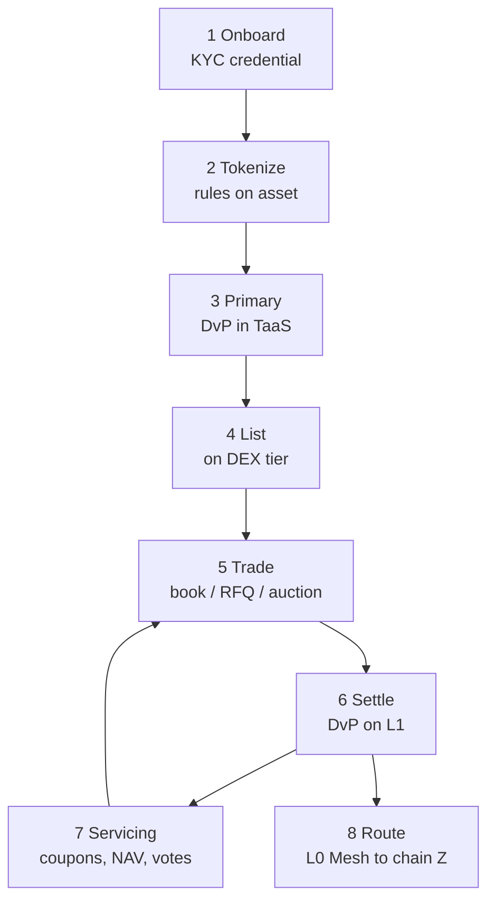
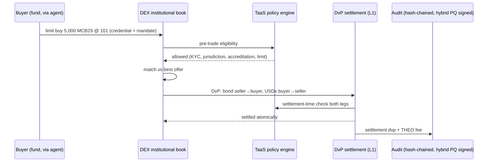

# TaaS ↔ DEX integration

TaaS creates and governs the asset; the DEX gives it a market. They share identity, the policy
engine, the settlement contracts, the audit trail and the L0 Mesh — so there is exactly one rulebook.

## Lifecycle

| Step | TaaS | DEX |
| --- | --- | --- |
| Onboard | Licensed KYC provider issues a credential; party record in TaaS | Wallet / agent DID presents the credential to enter the institutional tier |
| Tokenize | Asset factory with rules (jurisdictions, accreditation, limits, lock-up, min size) | Reads the rules; derives venue eligibility and tier |
| Primary | Issuer distributes via TaaS DvP (book-building, allocations) | Optional: primary via batch auction on the DEX |
| List | Issuer requests listing; listing policy approves venue type, price bands, MM | Market created with the asset's policy hook attached |
| Trade | — | Pre-trade check calls TaaS policy; orders rest only if eligible |
| Settle | Same DvP contract; settlement-time policy check | Fill → DvP instruction; atomic on L1 |
| Servicing | Coupons, redemptions, NAV, votes, pauses | Positions on the book/escrow are included in record-date snapshots; paused assets halt their markets |
| Route | Canonical supply on L1 | Intent router delivers to chain Z through L0 Mesh; destination enforces the same rules |

## Interfaces
| Interface | Direction | Shape |
| --- | --- | --- |
| `policy.check(asset, from, to, amount, kind)` | DEX → TaaS | Explained allow/deny (same as `POST /api/compliance/check` in the TaaS sandbox) |
| `settlement.dvp(assetLeg, cashLeg)` | DEX → L1 | Atomic; returns trade id + audit sequence |
| `asset.events` (pause, coupon record date, redemption, rule change) | TaaS → DEX | Halts / adjusts markets, re-checks resting orders |
| `listing.request / approve` | Issuer → DEX | Venue type, price bands, market maker, trading hours |
| `credential.present` | Wallet/agent → DEX | Verifiable presentation; DEX caches eligibility with expiry |
| `mesh.route(intent)` | DEX → L0 Mesh | Hops, fees, ETA; policy re-checked per hop |

## Secondary trade, end to end

## Rules that keep the two tiers apart
- A permissioned RWA token can never be deposited into an open-tier pool (transfer hook rejects the pool address).
- Cash legs bridge tiers: a permissionless stablecoin can be swapped for a tokenized deposit only through a regulated issuer's mint/redeem.
- Agents trade only inside their delegation: venue, asset class, notional and time limits are checked from the DID mandate before the order reaches policy.

## What the sandbox already proves
The private TaaS sandbox implements the policy engine, price-time order book, DvP, coupons and L0 Mesh routing in one service. The DEX build splits that into: venue engines, an on-chain settlement contract and policy hook, and an intent router — keeping the same policy semantics and test cases.
