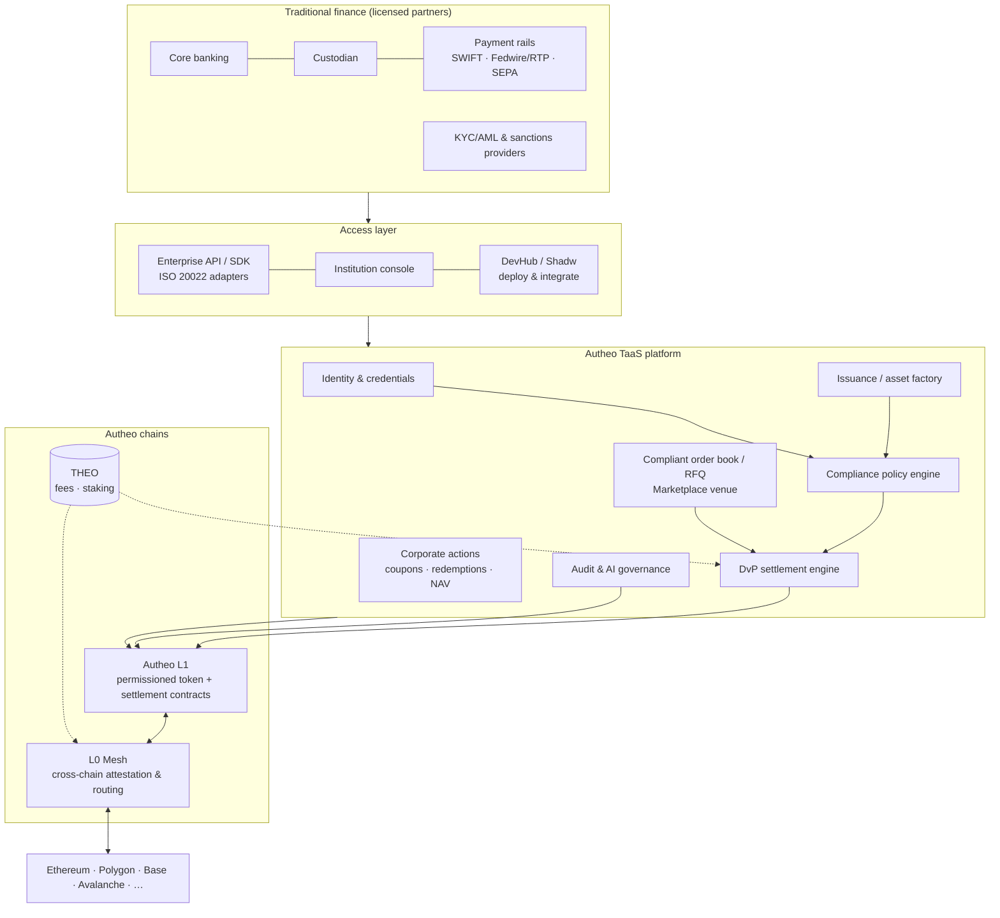

# Architecture

## Components (v0 module → production component)

| Layer | v0 | Production | Autheo building block |
| --- | --- | --- | --- |
| Identity | `Platform.onboard/setKyc` | Verifiable credentials issued by licensed KYC providers; wallet ↔ legal-entity binding | Autheo Identity |
| Policy | `src/policy.js` | Same rule model compiled to an on-chain compliance module (ERC-3643/T-REX style `canTransfer`), plus off-chain screening | L1 smart contracts + AI governance |
| Issuance | `Platform.tokenize/mint` | Asset factory contracts, document hashes (OM/prospectus) anchored, issuer/agent roles | L1 + DevHub templates |
| Trading | `placeOrder/match` | Order book + RFQ for block trades, operated under a partner's ATS/MTF licence | Marketplace |
| Settlement | `settleDvP` | Atomic DvP contract vs tokenized deposits / regulated stablecoins; PvP for FX | L1 |
| Corporate actions | `payCoupon/redeem` | Scheduled, oracle-fed (rates, NAV) programmable actions | L1 + oracles |
| Interop | `src/mesh.js` | Canonical supply on L1; mesh attestations lock/mint elsewhere; rules enforced on every chain | L0 Mesh |
| Economics | `src/fees.js` | THEO fees, staking tiers for institutions/relayers | THEO |
| Audit | `src/audit.js` | Hash-chained log with periodic root anchoring on L1, regulator read access | L1 + AI governance |
| Delivery | `server.js`, `shadw.yml` | Multi-tenant service per institution, deployed via DevHub/Shadw | DevHub |

## Design principles

1. **Policy travels with the asset.** Every movement — issuance, transfer, DvP leg, coupon, cross-chain hop — is evaluated by the same engine and the result is explainable.
2. **Atomic settlement.** Both DvP legs are validated before either moves; partial settlement is impossible.
3. **Canonical home, many destinations.** Supply of record stays on Autheo L1; L0 Mesh handles representation elsewhere.
4. **Partners hold licences, Autheo runs rails.** Autheo never takes custody of client assets in the target model.
5. **Everything audited.** Append-only, tamper-evident, verifiable by third parties.
