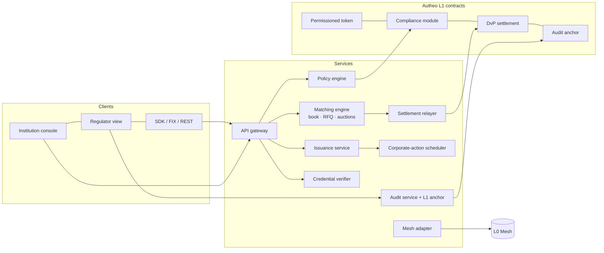

# Build plan

Development happens in a private repository; this page is its plan of record.
Milestones M0–M6 sit inside the phases of the [Roadmap](ROADMAP.md). **Each milestone ends with exit tests a stranger can run**;
a milestone is not done until they pass in CI and on a shared environment.

## Shape of the system (containers)

## Repository layout (proposed)

| Path | Contents |
| --- | --- |
| `packages/policy` | Rule model, evaluator, explanations; one implementation shared by API pre-checks and test vectors for the contract |
| `contracts/` | Token, compliance module, DvP, audit anchor, mesh lock/release; invariant tests |
| `services/api` | REST/WebSocket gateway, authn (mTLS + API keys), tenancy |
| `services/matching` | Price-time book, RFQ, batch auction; deterministic replay |
| `services/settlement` | Builds and submits DvP transactions; retries; reconciliation |
| `services/corporate-actions` | Record-date snapshots incl. book/escrow positions; coupon, redemption, NAV |
| `services/audit` | Append-only log, hash chain, periodic L1 anchoring, verification endpoint |
| `services/mesh` | Quote and route via L0 Mesh; per-hop policy re-check |
| `apps/console`, `apps/regulator` | Institution and regulator UIs |
| `sdk/` | TypeScript client first; FIX gateway later |
| `infra/` | Shadw / DevHub deployment, environments, observability |
| `docs/adr/` | Architecture decision records (one per decision in [Decisions and risks](DECISIONS-AND-RISKS.md)) |

## Milestones and exit tests

| Milestone | Phase | Scope | Exit tests (all must pass) |
| --- | --- | --- | --- |
| **M0-V Discovery** | 0 | Runs beside M0 and gates M1: test value and viability before building further | Signed letter of intent from one cash-leg bank and one issuer (R-01), and from one designated market maker or buy-side institution committing to quote or buy the D-02 pilot asset, with target spread and depth recorded (R-05); usability test of the console prototype with 5 people from target institutions, findings logged; D-02, D-03, D-09 decided |
| **M0 Walking skeleton** | 0 | Repo, CI, one asset, one party pair, policy engine library, in-memory DvP, audit chain, console stub | CI green on every push; a scripted onboarding → mint → DvP → audit-verify run passes end to end; policy engine returns all checks with reasons for 100 % of the sandbox's test vectors |
| **M1 Policy engine as a service** | 1 | Rule model frozen v1, REST `policy.check`, explanation format, test-vector suite | ≥ 200 test vectors incl. every rule in [Compliance](COMPLIANCE.md); property tests: no allowed movement violates a rule; p95 `policy.check` < 50 ms at 200 req/s on the shared environment |
| **M2 L1 contracts** | 1 | Permissioned token + compliance module + DvP on Autheo L1 testnet; credential references | Invariant tests: total supply conserved; no transfer without `canTransfer` = true; DvP is atomic (fuzzed: a failing leg leaves both balances unchanged); external audit firm engaged; **STRIDE threat model per container merged in `docs/threat-model/`, each threat mapped to a mitigation and a test — `make threat-tests` rejects a forged attester quorum, relayer key misuse, audit-log truncation and an unauthorised pause or role grant**; a freeze is lifted only by a signed action from a named legal role (D-11), logged with its legal basis |
| **M3 Pilot issuance** | 1 | Persistent store, multi-tenancy, ISO 20022 / webhook adapters, design-partner asset on testnet | A design partner issues, distributes and pays one coupon on testnet using only the console/API; reconciliation report matches L1 to the unit; **appeal flow (D-11): freeze a seed investor, file an appeal through the API, the investor receives a reason and a ticket id, and the unfreeze or denial is recorded within the SLA** — the test reads the audit-log timestamps and fails unless the reason + ticket id lands within 1 business day and the decision within 10 business days (D-11) |
| **M4 Institutional venue** | 2 | Matching engine (book + RFQ), DEX institutional tier integration, venue-operator controls | Deterministic replay of a day's orders reproduces fills bit-for-bit; pre-trade rejects ≥ 99 % of ineligible orders (rest caught at settlement, none settled); first secondary trade of a TaaS asset on the DEX settles DvP against tokenized deposits (joint milestone); threat model in `docs/threat-model/` updated for the matching engine, venue-operator controls and DEX tier, and `make threat-tests` rejects spoofed orders, venue-operator privilege misuse and DEX-side repudiation |
| **M5 Servicing and proofs** | 2–3 | Oracle-fed corporate actions, zkTLS proof of reserves, audit anchoring live | Coupon paid to holders whose units rest on the book; proof-of-reserves verifiable by a third party; audit root anchored at the agreed interval with zero gaps over 30 days |
| **M6 Cross-chain** | 3 | L0 Mesh routes to one external chain, rules enforced on the destination | RWA bought from another chain arrives with its rules intact; supply of record unchanged after 1,000 round trips in test; a destination-chain holder checks their units against the L1 supply of record using only public endpoints, and the check fails when the test forges an attestation; threat model updated and `make threat-tests` rejects a destination-chain mint that bypasses the rules |

Phase 4 (TaaS at scale: self-serve issuance, white-label) is planned after M6 and is not broken into milestones yet.

## How work is tested

- **Policy**: table-driven test vectors shared between the TypeScript engine and the contract tests, so the off-chain pre-check and the on-chain check cannot drift.
- **Contracts**: invariant and fuzz tests; external audit before any mainnet value.
- **Matching**: deterministic replay; recorded sessions as regression tests.
- **Settlement**: chaos tests (L1 halt, reverted transaction, cash shortfall) must end in Committed or Failed, never in between.
- **Security**: STRIDE threat model per service before M2; penetration test before the pilot; post-quantum profile per tenant ([Security](SECURITY-PQC.md)).

## Delivery measures

Deployment frequency, lead time for changes, change-failure rate and time to restore, reported per milestone (Accelerate's four key metrics).

## Estimate and team (reference class, not a promise)

**Reference class:** IT projects. Flyvbjerg and Budzier's study of 1,471 IT projects (*Why Your IT Project May Be Riskier
Than You Think*, Harvard Business Review, 2011) found an average cost overrun of 27 %, and one project in six with a cost
overrun near 200 % and a schedule overrun near 70 %. This plan uses those figures as its outside view: **P50 = inside
estimate × 1.3**, **P80 = × 1.7** (assumption derived from that study, not a forecast for this team). A dedicated
reference class of institutional tokenization / DvP builds is not yet assembled (decision D-13).

| Milestone | Inside estimate (weeks) | People | Person-weeks | P50 weeks (× 1.3) | P80 weeks (× 1.7) |
| --- | --- | --- | --- | --- | --- |
| M0-V Discovery (parallel to M0) | 6 | 2 | 12 | 8 | 11 |
| M0 Walking skeleton | 6 | 5 | 30 | 8 | 11 |
| M1 Policy engine as a service | 8 | 5 | 40 | 11 | 14 |
| M2 L1 contracts | 12 | 6 | 72 | 16 | 21 |
| M3 Pilot issuance | 10 | 6 | 60 | 13 | 17 |
| M4 Institutional venue | 16 | 7 | 112 | 21 | 28 |
| M5 Servicing and proofs | 12 | 6 | 72 | 16 | 21 |
| M6 Cross-chain | 12 | 6 | 72 | 16 | 21 |

Totals are sums of the rounded milestone rows (each milestone is rounded up on its own): M0–M3 inside 36 weeks, P50 48, P80 63; M4–M6 inside 40, P50 53, P80 70; M0–M6 inside 76, P50 101, P80 133. M0-V runs beside M0 and is not added. Inside estimates for M4–M6 are assumptions with wider uncertainty than M0–M3. The Roadmap's phase
windows are P50 targets; R-10 fires when a milestone passes its P80.

**Team** (M0–M3): 1 lead architect (owns conceptual integrity of `packages/policy` and `contracts/` — one mind for the rule
model on both sides), 2 backend, 1 smart-contract, 1 frontend, part-time security and counsel; product lead and BD run M0-V.
Team boundaries follow the containers above (Conway's law): policy + contracts, venue + settlement, apps.

## First six weeks (M0)

1. Repo scaffold, CI, lint, test runner, ADR template.
2. Port the sandbox policy model into `packages/policy` with its test vectors.
3. In-memory ledger + DvP with the atomicity test.
4. Audit chain + verify endpoint.
5. Console stub showing an explained allow/deny.
6. Scripted end-to-end run in CI; M0 exit review.
