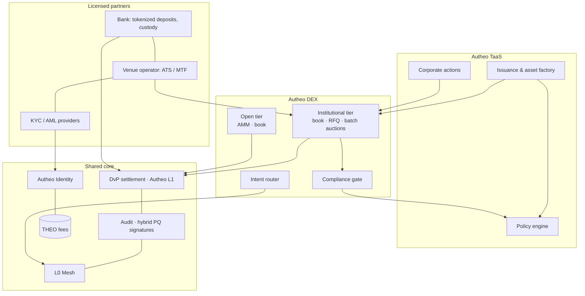

# Integration with the Autheo DEX

TaaS creates and governs tokenized assets; the [Autheo DEX](https://github.com/ThothDivision/autheo-dex)
gives them a market. Together they form one institutional stack with **one rulebook**: the same
identity credentials, policy engine, DvP settlement contracts, audit trail and L0 Mesh routes.

> Banks adopt tokenization because there is somewhere to trade, settle and move the asset afterwards. The DEX is that somewhere.

## Why integrate rather than list elsewhere
| Without the DEX | With the DEX |
| --- | --- |
| Tokens sit in custody; secondary trading by phone/email with the transfer agent | Continuous or auction-based secondary market with eligibility enforced on every fill |
| Every external venue re-implements (or ignores) the asset's transfer rules | Venue calls the TaaS policy engine — rules cannot drift |
| Settlement T+1/T+2 through intermediaries | Atomic DvP on Autheo L1 against tokenized deposits |
| Liquidity trapped on one chain | Intent routing across L0 Mesh destinations, rules enforced on each |
| Corporate actions reconciled manually against venue positions | Record-date snapshots include book/escrow positions automatically |

## Integration model

## Asset lifecycle across both products
| # | Stage | TaaS does | DEX does | Bank / partner does |
| --- | --- | --- | --- | --- |
| 1 | Onboard | Party record, credential reference | Accepts credential presentation from wallet or agent DID | KYC provider verifies; bank custodies keys if required |
| 2 | Tokenize | Asset factory with transfer rules and documents | Derives tier and venue eligibility from the rules | Issuer / bank structures the instrument |
| 3 | Primary | Book-building, allocations, DvP | Optional primary batch auction | Bank supplies tokenized-deposit cash leg |
| 4 | Listing | Listing request with venue type, price bands, designated MM | Creates market, attaches policy hook | Venue operator approves under its licence |
| 5 | Secondary | — | Pre-trade check → match → DvP instruction | Market makers quote; bank clients trade via API/FIX |
| 6 | Settlement | Settlement-time policy check, audit entry | Final fill confirmation | Cash moves as tokenized deposits |
| 7 | Servicing | Coupons, NAV, redemptions, votes, pauses | Includes resting/escrowed positions; halts paused markets | Paying agent / bank funds coupons |
| 8 | Cross-chain | Canonical supply stays on L1 | Routes intents to destination chains | Destination custodians recognise mesh attestations |

## What each side exposes
| Interface | From → to | Purpose |
| --- | --- | --- |
| `policy.check` | DEX → TaaS | Explained allow/deny for an order or fill (KYC, sanctions, jurisdiction, eligibility, limits, lock-up, min size) |
| `asset.events` | TaaS → DEX | Pause, rule change, record date, redemption window → halt, re-check, snapshot |
| `listing.request` | Issuer → TaaS → DEX | Venue type, price bands, trading hours, market maker |
| `settlement.dvp` | DEX → L1 | Atomic asset + cash legs, trade id, audit sequence |
| `credential.present` | Wallet / agent → DEX | Eligibility proof with expiry, no PII on-chain |
| `mesh.route` | DEX → L0 Mesh | Hops, fees, ETA; policy re-checked per hop |
| `attestation.zktls` | Oracle → TaaS/DEX | Proof of reserves, balances, NAV sources |

## Bank roles
- **Issuer of the cash leg** — tokenized deposits are the settlement asset for every institutional fill; the bank earns float and fees.
- **Issuer or arranger of RWAs** — bonds, funds and loans tokenized through TaaS gain day-one liquidity on the DEX.
- **White-label venue** — a bank runs its own branded institutional market on DEX rails under its licence.
- **Client access** — wealth and treasury clients trade via the bank's API; the bank keeps the client relationship and custody.

## Liquidity plan
1. **Anchor assets first**: tokenized money-market fund and short-dated bonds (deep, NAV-anchored), then private credit via periodic auctions.
2. **Designated market makers** per listing with quoting obligations and THEO rebates.
3. **Issuer-reserved inventory** at primary for the market maker.
4. **Open-tier depth** in THEO and stable pairs pays for routing and fees.
5. **Cross-chain demand**: intents from other chains reach Autheo-listed RWAs through the L0 Mesh.

## Revenue model (indicative)
| Stream | Payer | Unit |
| --- | --- | --- |
| Issuance | Issuer | bps of issued notional |
| Servicing | Issuer | per corporate action / per holder |
| Trading | Both sides | bps per fill, THEO-denominated, staking discounts |
| Settlement | Venue / participants | bps per DvP leg |
| Routing | Router users | per L0 Mesh hop |
| White-label | Bank | platform licence + SLA tier |

## Joint roadmap
| Phase | TaaS | DEX | Joint milestone |
| --- | --- | --- | --- |
| 1 | Pilot issuance on L1, policy engine as a service | Open tier MVP | Shared policy-hook spec frozen |
| 2 | Partner bank tokenized deposits, first RWA | Institutional tier pilot with venue partner | First secondary trade of a TaaS asset on the DEX, DvP against deposits |
| 3 | zkTLS proof of reserves, corporate-action automation | Batch auctions, sealed orders, agent trading | Coupon paid to holders whose units rest on the book |
| 4 | Multi-jurisdiction rule packs | Cross-chain intent router | RWA bought from another chain, delivered with rules intact |
| 5 | White-label TaaS | White-label venues | Bank runs its own branded market end to end |

## Success measures
Time from term sheet to first trade · share of fills settled atomically · policy rejections caught pre-trade vs at settlement · average spread and depth per listing · cross-chain volume · incidents and pauses.
