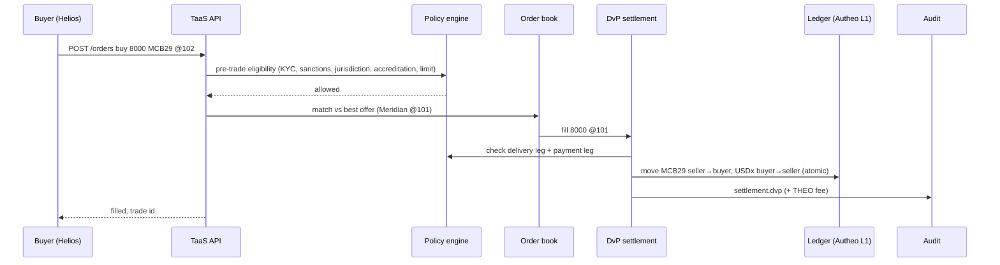

# Deployable flows

All flows run in the sandbox today (`npm start`, console tabs or curl). IDs refer to the seed data.

## 1. Institution onboarding
```
POST /api/parties            {"name":"Acme Pension","type":"institution","jurisdiction":"US"}   -> kyc: pending
POST /api/parties/:id/kyc    {"status":"verified","accredited":true}                           (licensed KYC provider callback)
```
Production: provider issues a verifiable credential; wallet(s) bound to the legal entity.

## 2. Tokenize a real-world asset
```
POST /api/assets {"issuerId":"meridian","symbol":"MCB31","name":"Meridian 4.5% 2031","assetClass":"bond",
  "faceValue":100,"couponRateBps":450,"chains":["ethereum"],
  "rules":{"requiresAccreditation":true,"jurisdictionsAllowed":["US","DE","SG"],"maxHoldingPerInvestor":50000,"minTransfer":10}}
POST /api/assets/:id/mint {"to":"meridian","amount":100000}
```

## 3. Primary distribution (DvP against tokenized deposits)
```
POST /api/settlements/dvp {"assetId":"mcb-2029","seller":"meridian","buyer":"lionsgate-sg","quantity":5000,"price":100}
```
Delivery leg (bond) and payment leg (USDx) are both policy-checked, then applied atomically.

## 4. Secondary trading (institutional DEX)
```
POST /api/orders {"assetId":"mcb-2029","partyId":"helios","side":"buy","quantity":8000,"price":102}
```
Pre-trade eligibility check → price-time matching against resting offers → each fill settles via DvP. Ineligible buyers (e.g. `retail-ray`) are rejected before reaching the book.

## 5. Corporate actions
```
POST /api/assets/mcb-2029/coupon  {"cashAssetId":"usdx"}      # pays eligible holders, withholds blocked ones
POST /api/assets/mcb-2029/redeem  {"from":"northwind","amount":100,"cashAssetId":"usdx"}
POST /api/assets/mcb-2029/pause   {"paused":true}              # regulatory/issuer freeze
```

## 6. Cross-chain via L0 Mesh
```
POST /api/mesh/quote    {"assetId":"mcb-2029","partyId":"northwind","amount":1000,"toChain":"ethereum"}
POST /api/mesh/transfer {"assetId":"mcb-2029","partyId":"northwind","amount":1000,"toChain":"ethereum"}
```
Only chains enabled by the issuer are reachable; holder eligibility is re-checked on every move.

## 7. Regulator / auditor
```
GET /api/audit          # latest events with actor attribution
GET /api/audit/verify   # recomputes the SHA-256 chain -> {"ok":true,"head":...}
POST /api/compliance/check {...}   # explain why a hypothetical transfer would pass/fail
```

## Sequence: secondary trade end to end


