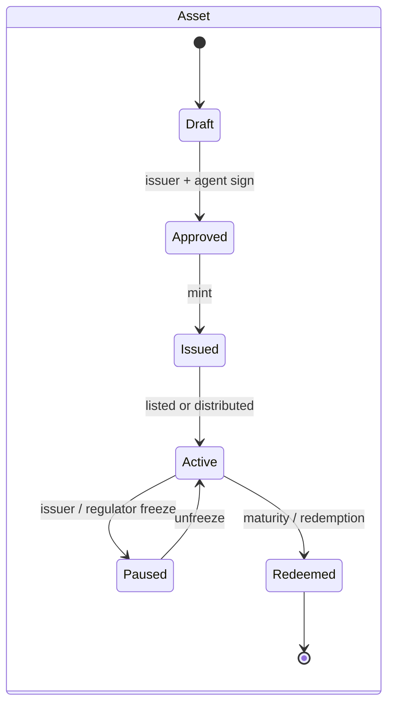
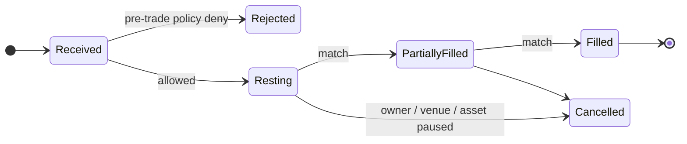
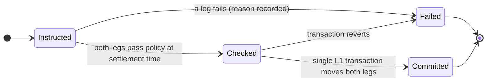

# How it works

This page walks one asset through TaaS end to end — who acts, what state each object is in, what happens when something
goes wrong — so a reviewer can check the design without reading code. Terms are defined in the glossary at the bottom;
component names match [Architecture](ARCHITECTURE.md) and the [build plan](BUILD-PLAN.md).

## The answer in one paragraph

An institution is onboarded once by a licensed KYC provider and receives a **credential**. An issuer defines an **asset**
together with its **rule set** (who may hold it, where, how much, when). From then on every movement of that asset —
mint, primary sale, secondary fill, coupon, redemption, cross-chain hop — calls the same **policy engine**, which answers
allow or deny with a reason for every check. Trades settle by **delivery versus payment (DvP)** on Autheo L1: the asset leg
and the cash leg (tokenized deposits from a partner bank) both pass the policy check and then move in one transaction, or
neither moves. Every decision and movement is written to a hash-chained **audit log** whose root is anchored on L1.
Regulated roles (custody, venue, transfer agent, cash) stay with licensed partners; Autheo runs the rails.

## Who does what

| Actor | Holds | Does in TaaS | Licence held by |
| --- | --- | --- | --- |
| Investor (institution) | Credential, wallet(s) bound to its legal entity | Subscribes, trades, receives coupons | — (is the regulated client of its bank/broker) |
| Issuer | Asset definition, documents | Creates the asset and its rules, mints, funds coupons | Issuer + transfer agent |
| KYC provider | Verification records (off-chain) | Issues and revokes credentials | KYC provider |
| Partner bank | Cash, tokenized deposits | Supplies the cash leg; may custody keys | Bank |
| Custodian | Keys (MPC/HSM) | Signs on behalf of clients that do not self-custody | Custodian |
| Venue operator | Market rules | Approves listings, supervises trading on the DEX institutional tier | ATS / MTF operator |
| Regulator / auditor | Read access | Verifies the audit chain, queries any decision | — |
| **Autheo** | Code, rails | Runs policy engine, settlement contracts, order book software, L0 Mesh, audit | **None** (technology provider) |

## Core objects

| Object | Key fields | Lives |
| --- | --- | --- |
| Party | legal entity id, type, jurisdiction, credential refs, wallets | Off-chain DB; wallet ↔ party binding hashed on L1 |
| Credential | issuer (KYC provider), subject, claims (KYC level, accreditation, jurisdiction), expiry, revocation id | Holder wallet; only a reference and status on L1 |
| Asset | symbol, class, issuer, documents hash, chains enabled, status | L1 token contract + off-chain metadata |
| Rule set | eligibility, jurisdictions, holding limit, minimum size, lock-up, transfer windows | L1 compliance module (`canTransfer`) + same model off-chain for pre-checks |
| Order | party, asset, side, size, price/limit, time-in-force | Order book (off-chain, venue-supervised) |
| Settlement | trade id, asset leg, cash leg, policy results, status | L1 DvP contract |
| Corporate action | type (coupon, redemption, NAV, vote, pause), record date, amounts | Scheduler + L1 |
| Audit event | sequence, actor, action, inputs hash, result, previous hash | Append-only store, root anchored on L1 |

## Lifecycle state machines

A fill is never "half settled": the only end states are Committed (both legs moved) or Failed (neither moved).

## Worked example: a bond from term sheet to second coupon

Illustrative names and numbers; timings are design targets, not measurements.

| Step | What happens | Calls | Policy checks | Result |
| --- | --- | --- | --- | --- |
| 1 | Helios Asset Management is onboarded by a KYC provider | `POST /parties`, provider callback | — | Credential: institution, US, accredited, expires in 12 months |
| 2 | Meridian defines a 4.5 % 2031 bond, 100 face, US/DE/SG holders, accredited only, max 50,000 units per holder, min 10 | `POST /assets` | Rule set validated | Asset **Draft** |
| 3 | Issuer and transfer agent approve; 1,000,000 units minted to the issuer | `POST /assets/:id/mint` | mint allowed to issuer | **Issued** |
| 4 | Primary: Helios buys 20,000 units at 100 | `POST /settlements/dvp` | KYC, sanctions, jurisdiction, accreditation, holding limit — both legs | **Committed**: 20,000 bonds → Helios, 2,000,000 USD-deposit tokens → Meridian |
| 5 | Venue operator lists the bond on the DEX institutional tier | `listing.request` | venue type allowed by rules | **Active** |
| 6 | Helios sells 5,000 to Lionsgate (SG) at 101.20 | `POST /orders` → match → DvP | pre-trade and at settlement | Filled, **Committed** |
| 7 | A retail account tries to buy | `POST /orders` | accreditation **fails** | **Rejected** before the book, reason shown |
| 8 | Coupon date: 2.25 per unit for the half-year | `POST /assets/:id/coupon` | each holder re-checked; blocked holders' coupons withheld to escrow | Paid to eligible holders incl. units resting on the book |
| 9 | Lionsgate moves 1,000 units to Ethereum | `mesh.quote` / `mesh.route` | eligibility re-checked; Ethereum enabled for this asset | Locked on L1, represented on Ethereum; supply of record unchanged |
| 10 | Auditor verifies the year | `GET /audit/verify` | — | Chain recomputed, root matches the L1 anchor |

## When something goes wrong

| Event | Detected by | Automatic response | Human step |
| --- | --- | --- | --- |
| Sanctions hit on a holder | Screening feed → credential revoked | Orders cancelled, transfers denied, coupons to escrow | Compliance officer at the KYC provider / bank decides release or report |
| Credential expires | Policy engine on next check | Same as above, with "expired" reason | Investor renews with its provider |
| Cash leg short at settlement | DvP check | Settlement **Failed**, no leg moves, order may re-rest | Venue rules decide penalties |
| Asset paused by issuer or regulator | `asset.events` | Book halted, resting orders kept or cancelled per venue rules | Issuer/regulator lifts pause |
| Oracle stale (rates, NAV) | Freshness threshold | Corporate action deferred, alert | Paying agent confirms source |
| L1 halt or congestion | Health checks | Matching continues off-chain; settlement queue paused; no fill marked settled | Ops incident process |
| Mesh attestation disputed | Attester quorum mismatch | Hop not completed; asset stays locked on L1 | Mesh operators resolve; investor notified |
| Key compromise at a client | Custodian / client report | Wallet unbound from party, transfers denied | Re-binding after custodian procedure |
| Policy change by issuer | Rule-set update event | New rules apply to new movements; existing holders evaluated at next movement | Venue notified; AI-governance review logs the change |

## What is on-chain and what is not

On L1: token balances, rule sets, credential **references and status** (never personal data), DvP settlement records, audit
roots, mesh lock/release records. Off-chain: identity documents, KYC files, order book, full audit entries, documents
(only their hashes on-chain). This follows privacy by design and keeps erasure requests possible without rewriting the chain.

## Glossary

**Credential** — signed claim from a KYC provider about a party, with expiry. **Rule set** — the asset's transfer rules.
**Policy engine** — evaluates a proposed movement against the rule set and credentials; returns every check with pass/fail.
**DvP** — delivery versus payment: asset and cash move together or not at all. **Tokenized deposit** — a bank liability
represented on-chain; the institutional cash leg. **L0 Mesh** — Autheo's cross-chain attestation and routing layer.
**Supply of record** — the canonical balance on Autheo L1. **THEO** — Autheo's network token (fees, staking), not a cash leg.
